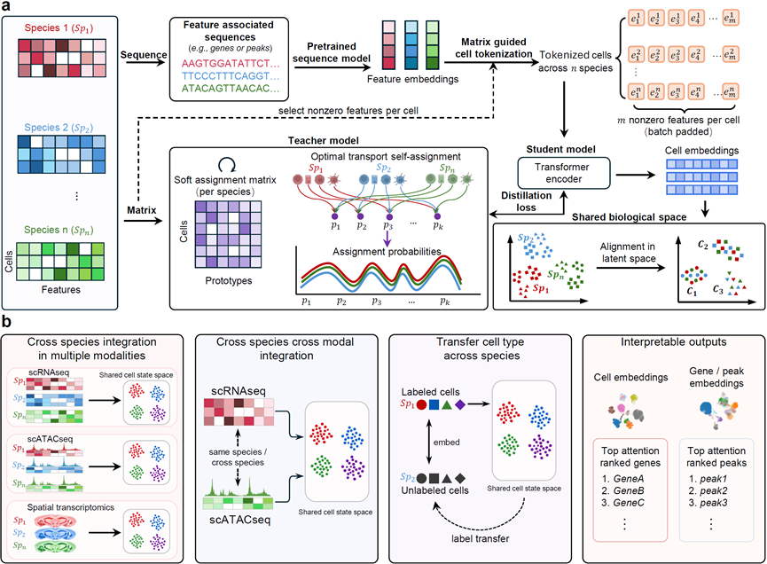

<p align="center">
  
</p>

<p align="center">
  <strong>Cross-species representation learning for single-cell data</strong>
</p>

<p align="center">
  <a href="#overview">Overview</a> &nbsp;&middot;&nbsp;
  <a href="#environment-setup">Installation</a> &nbsp;&middot;&nbsp;
  <a href="#input-data">Input data</a> &nbsp;&middot;&nbsp;
  <a href="#python-workflow">Workflow</a> &nbsp;&middot;&nbsp;
  <a href="#examples">Examples</a>
</p>

## Overview

Henosis supports representation learning and integration across species for
single-cell data. The core workflow takes an AnnData object and precomputed gene
embeddings for each species, converts cells into gene token sequences, and uses
these inputs for model training, embedding inference, and visualization.

<p align="center">
  <strong>Single-cell data &rarr; Gene tokens &rarr; Cross-species learning &rarr; Cell embeddings</strong>
</p>



<p align="center">
  <em>Henosis framework: (a) representation learning and alignment; (b) downstream applications.</em>
</p>

The framework combines sequence-based feature embeddings, cell tokenization,
and teacher–student learning for cross-species alignment. Applications include
cross-species and cross-modal integration, cell type transfer, and interpretation.

Explore the [downstream application datasets](https://biobigdata.nju.edu.cn//HenosisDataset/).

## Environment setup

After cloning, run the commands below from the repository root, which contains
this README and `Henosis/`. Once the dependencies are available, you can import
`Henosis` directly from source without installing this project. For the notebooks
in the repository root, select a kernel from the same environment and keep the
working directory at the repository root.

The configuration in [`environment.yml`](environment.yml) is based on the author's
`hle_env` environment and targets the tokenization, training, and evaluation
workflow below using existing h5ad and `avg.embeddings` files. The reference setup
is Linux x86_64, Python 3.11.15, PyTorch 2.6.0 with CUDA 12.4, and Scanpy 1.11.5.
Other platforms have not been validated.

Run from the repository root. The environment file pins PyTorch to 2.6.0;
the final command selects the CUDA 12.4 build used by the reference environment:

```bash
conda env create -f environment.yml
conda activate hle_env
python -m pip install torch==2.6.0+cu124 --index-url https://download.pytorch.org/whl/cu124
```

GPU training requires an available NVIDIA GPU and a driver compatible with CUDA
12.4. The PyTorch installation command follows the
[official instructions for previous versions](https://pytorch.org/get-started/previous-versions/#v260).

**Validation status:** Conda dependency resolution (`--dry-run`) has passed.
Installation in a fresh environment, including pip dependencies, and end-to-end
training have not yet been validated.

Before GPU training, run the environment check below and confirm that the output
includes `CUDA available: True`.

<details>
<summary><strong>CPU installation for import checks and preprocessing</strong></summary>

For import checks or CPU preprocessing, replace the PyTorch installation command
above with:

```bash
python -m pip install torch==2.6.0+cpu --index-url https://download.pytorch.org/whl/cpu
```

</details>

<details>
<summary><strong>Register a Jupyter notebook kernel</strong></summary>

Register the environment as a notebook kernel, then select it in your notebook:

```bash
python -m ipykernel install --user --name hle_env --display-name "Python (hle_env)"
```

</details>

<details>
<summary><strong>Check the environment and CUDA availability</strong></summary>

After installation, check the environment from the same directory:

```bash
python - <<'PY'
import sys
from importlib.metadata import version
import numpy as np
import torch
import scanpy as sc
from datasets import Dataset
from Henosis.dataprocess.h5a import H5ADTokenizer
from Henosis import data
from Henosis.henosis import Henosis
from Henosis.evaluate import evaluate_integration

print("Python:", sys.version.split()[0])
print("PyTorch:", torch.__version__)
print("Scanpy:", version("scanpy"))
print("CUDA runtime:", torch.version.cuda)
print("CUDA available:", torch.cuda.is_available())
assert torch.equal(torch.from_numpy(np.ones((2, 3), dtype=np.float32)), torch.ones(2, 3))
print("Core imports and NumPy/PyTorch interop: OK")
PY
```

This check verifies imports and NumPy/PyTorch interoperability; training also
requires the data and embeddings described below.

</details>

## Input data

The example below uses RNA data and precomputed `avg.embeddings` files. Complete
quality control first, then prepare an h5ad file and its corresponding embedding
file for each species.

| Input | Requirements |
| --- | --- |
| `adata.var_names` | Gene names or IDs matching keys in the embedding dictionary. Genes without a corresponding embedding are excluded from token sequences. |
| Expression matrix | The tokenizer uses `adata.layers["counts"]` when available, otherwise `adata.X`. The current implementation calls `.toarray()`, so the input must be a sparse matrix supporting that method. Genes with values greater than zero are selected for each cell. |
| Training representation | This example uses precomputed `adata.obsm["X_pca"]`, with 50 dimensions recommended. All species must use representations with the same number of dimensions. Other existing representations, such as `X_pca_harmony`, can also be specified. |
| `avg.embeddings` | A dictionary of `{gene_name_or_id: one_dimensional_vector}`, read with `pickle.load()`. Embedding vectors used by the same model must have the same dimension. |
| Species identifiers | Use matching species keys across the AnnData, embedding, and metadata configurations. The AnnData and embedding dictionaries must also use the same species order. |

Species IDs are generated in input dictionary order; no manual changes to
`Henosis/const.py` are needed. Use the same embedding files for tokenization and
model construction to keep gene token IDs consistent. The current RNA tokenizer
converts the filtered expression matrix to a dense array, so allow sufficient
memory for large datasets.

## Python workflow

Run the following code blocks in order, replacing the data paths with your own.
The example assumes that each input already contains a 50-dimensional `X_pca`.
Use the linked notebooks below to complete the training step.

### 1. Load data and generate tokens

```python
import scanpy as sc
from Henosis.dataprocess.h5a import H5ADTokenizer
from Henosis import data

species_to_adata = {
    "homo_sapiens": sc.read_h5ad("data/homo_sapiens.h5ad"),
    "mus_musculus": sc.read_h5ad("data/mus_musculus.h5ad"),
}
species_to_embed_file = {
    "homo_sapiens": "embeddings/homo_sapiens.avg.embeddings",
    "mus_musculus": "embeddings/mus_musculus.avg.embeddings",
}

assert list(species_to_adata) == list(species_to_embed_file)
species_mapping = {
    species: index for index, species in enumerate(species_to_adata)
}

tokenized = H5ADTokenizer(
    species_to_adata,
    species_to_embed_file,
).process_species_adata()
```

`tokenized` is a `{species: AnnData}` dictionary. Tokenization modifies the input
AnnData objects in place and adds the following fields:

- `adata.uns["gene_embeddings"]`: gene embeddings.
- `adata.uns["gene_token"]`: mapping from genes to token IDs.
- `adata.uns["input_ids_flat"]`: concatenated token sequences for all cells.
- `adata.uns["input_ids_indptr"]`: offsets marking the start and end of each cell's sequence.

### 2. Create DataLoaders

```python
species_to_reps = {
    species: "X_pca" for species in tokenized
}
train_loader, test_loader = data.prepare_multispecies_dataloaders(
    tokenized,
    batch_size=128,
    species_to_reps=species_to_reps,
    batch_species=len(tokenized),
    num_workers=0,
)
```

Start with `num_workers=0` and adjust it to your machine's resources after the
workflow runs successfully. `test_loader` iterates over all cells in their
original order for embedding inference; it is not a held-out test split.

### 3. Create and train a model

This configuration uses the same `mean_pool` encoder as
[hippocampus.ipynb](hippocampus.ipynb). `embed_size` is inferred from the embeddings
loaded above. With `d_model=120`, both the embedding dimension and the number of
rows in the combined embedding matrix must be at least 120. Match the parameters
to your data and any checkpoint you intend to load.

```python
from Henosis.henosis import Henosis

first_adata = next(iter(tokenized.values()))
first_vector = next(iter(first_adata.uns["gene_embeddings"].values()))
embed_size = len(first_vector)

net = Henosis(
    embed_file=species_to_embed_file,
    d_model=120,
    embed_size=embed_size,
    latent_size=64,
    encoder_type="mean_pool",
    num_layers=1,
    species_mapping=species_mapping,
)
```

<a id="examples"></a>

The model is untrained at this point. See these notebooks for training loops,
loss functions, and optimizer settings:

| Example | Encoder | Description |
| --- | --- | --- |
| [hippocampus.ipynb](hippocampus.ipynb) | `mean_pool` | Training and evaluation with RNA data. |
| [pbmc1.ipynb](pbmc1.ipynb) | `set` | Training with the set encoder. |
| [atac0.ipynb](atac0.ipynb) | `set` | Training with ATAC data; follow the notebook's input preparation steps. |

Before running a notebook, update its data and checkpoint output paths and check
the model parameters. If you already have a `state_dict` saved from a `Henosis`
model with the same configuration, load it before evaluation:

```python
import torch

state_dict = torch.load(
    "checkpoints/henosis.pt",  # Replace with your checkpoint path.
    map_location="cpu",
    weights_only=True,
)
net.load_state_dict(state_dict)
```

When loading weights, use the same encoder type, model dimensions, species order,
and embedding files as during training.

### 4. Infer embeddings, visualize, and save results

The following code uses `net` after training or loading a checkpoint. Preserve
the original order of `test_loader` and pass the same `tokenized` dictionary used
to create it so that cell embeddings remain aligned with metadata.

```python
from Henosis.evaluate import evaluate_integration

integrated_adata = evaluate_integration(
    net,
    test_loader,
    species_to_adata=tokenized,
    embedding="protein",
    use_mot_correction=True,
    correction_by="inferred_species",
    correction_kwargs={
        "max_rounds": 10,
        "n_clusters": 10,
        "assignment_mode": "sinkhorn",
    },
    umap_colors=["species"],
)

integrated_adata.write_h5ad("integrated.h5ad")
```

`integrated_adata.X` contains the inferred cell embeddings. With MOT correction
enabled as above, the corrected representation is stored in
`integrated_adata.obsm["X_mot"]`, and UMAP coordinates are stored in
`integrated_adata.obsm["X_umap"]`.

If `adata.obs` has a `celltype` column for every species, add
`metadata_columns=["celltype"]` to the call above and set
`umap_colors=["species", "celltype"]`. If column names differ across species,
use the following mapping instead of `metadata_columns`, replacing the column
names with those in your data:

```python
species_to_metadata_columns = {
    "one": ["celltype"],  # Shared output column names.
    "homo_sapiens": ["coarse_cluster"],
    "mus_musculus": ["cluster"],
}
```

Pass this mapping to `evaluate_integration()` as
`species_to_metadata_columns=species_to_metadata_columns`. Include every species
in `tokenized`; columns in each list correspond by position to the output names
under `"one"`.

## Optional: tokenize h5ad files from directories

For existing h5ad and embedding files, you can also use the command-line entry
point from the repository root. The `--dry_run` option below checks and prints
file pairings:

```bash
python -m Henosis.dataprocess.h5a_flexible \
  --h5ad_directory ./data \
  --embed_directory ./embeddings \
  --save_directory ./tokenized \
  --dry_run
```

After checking the pairings, remove `--dry_run` to tokenize and save the results.
Existing output files are skipped. Matching first looks for an embedding file
with the sample name, then falls back to the species name. For complex sample
names, provide a JSON mapping from sample names to species names with
`--species_map mapping.json`.

## Optional: generate embeddings from sequences

The main workflow assumes that embeddings are already available. To generate
embeddings from sequences, the relevant tools include:

- [Henosis/dataprocess/extract.py](Henosis/dataprocess/extract.py): extract embeddings with ESM.
- [Henosis/dataprocess/torchdict.py](Henosis/dataprocess/torchdict.py): run ESM extraction in batches.
- [Henosis/dataprocess/evodict.py](Henosis/dataprocess/evodict.py): extract embeddings with Evo2.

These embedding tools require their respective environments. The core environment
includes `biopython` (`Bio`) for sequence handling and `scikit-misc` for highly
variable gene selection with the Seurat v3 method. Other preprocessing scripts
may also require `pysam` or `mygene`, which are not included in `environment.yml`.

## Examples of integration are included in the notebooks:
figure2 + hippocampus : [hippocampus.ipynb](hippocampus.ipynb)
figure2 + pancreas: [pancreas.ipynb](pancreas.ipynb)
figure2 + motor: [motor.ipynb](motor.ipynb)
figure2 + testis: [testis.ipynb](testis.ipynb)
figure3 + 15-species heart atlas spanning vertebrates and invertebrates: [heart.py](heart.py)
train:
nohup env CUDA_VISIBLE_DEVICES=0,1 OMP_NUM_THREADS=1 PYTHONUNBUFFERED=1 torchrun --standalone --nproc_per_node=2 heart.py --mode train --weights_pth your_weights.pth > logs/heart.log 2>&1 < /dev/null &
infer:
python heart.py --mode infer --metadata-columns Celltype --weights_pth your_weights.pth --output heart_runs/h5ad/result.h5ad
Note:
after [heart.py](heart.py) run, you need to run [rap.ipynb](rap.ipynb),which needs to use rapids-singlecell package(https://rapids-singlecell.scverse.org/en/latest/installation.html)
figure4 + human–mouse spatial brain : [agebrain.ipynb](agebrain.ipynb) [ageb.ipynb](ageb.ipynb)
figure5 + six-species cerebellar chromatin atlas : [btacsub.py](btacsub.py)
train:
nohup env CUDA_VISIBLE_DEVICES=0,1 OMP_NUM_THREADS=1 PYTHONUNBUFFERED=1 torchrun --standalone --nproc_per_node=2 btacsub.py --mode train --weights your_weights.pth --training-objective batch_knn --mmd-weight 1 > logs/btacsub.log 2>&1 < /dev/null &
infer:
python btacsub.py --mode infer --metadata-columns Celltype --weights your_weights.pth --batch-size 128 --embedding protein --output btacsub_runs/h5ad/result.h5ad
Note:
after  [btacsub.py](btacsub.py) run, you need to run [rap.ipynb](rap.ipynb),which needs to use rapids-singlecell package(https://rapids-singlecell.scverse.org/en/latest/installation.html)
figure6 : [pbmc1.ipynb](pbmc1.ipynb) [most.ipynb](mosp.ipynb)
